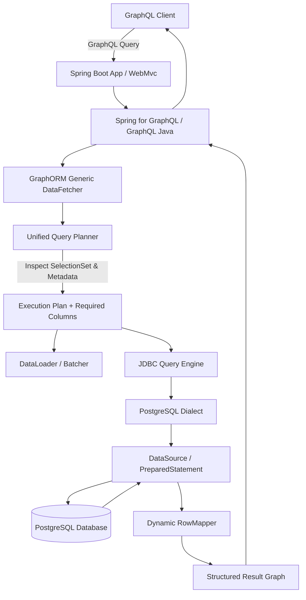

# GraphORM Architecture Guide

This skill provides the architectural foundation for GraphORM, a Java framework inspired by Prisma that integrates ORM capabilities with automatic GraphQL integration for Spring Boot applications.

## Core Vision & Developer Experience

GraphORM eliminates boilerplate across the Spring Boot + GraphQL + Database stack. Instead of manually writing Entity classes, DTOs, DAOs, RowMappers, DataFetchers, and Relationship Resolvers, the developer:
1. Defines relational models (`model`), read-only views (`view`), and composite types (`type`) in a Prisma-inspired schema file (`schema.graphorm`).
2. Defines the public GraphQL API in standard GraphQL SDL (`schema.graphqls`).
3. Runs the code generator to produce immutable Java models, view projection records, input types, and type-safe database clients (`GraphOrmClient`).
4. Boots the Spring Boot application, which automatically wires generic DataFetchers, analyzes GraphQL selection sets, generates optimal SQL projections (including joins and aggregations for views), and batches relation loads.

## Model Categories
- **Regular Models (`model`)**: Physical database tables with full CRUD capabilities.
- **View Models (`view`)**: Read-only projections combining multiple models, joins, aggregations, and computed expressions (supporting Database-Backed and GraphORM-Defined strategies).
- **Composite Types (`type`)**: Reusable nested value objects embedded within models or views.

## Module Boundaries & Responsibilities

The codebase follows a strict multi-module Maven structure:

```text
graphorm/
├── pom.xml                               # Root multi-module POM
├── AGENTS.md                             # Global AI engineering rules
├── docs/                                 # Architectural and design documentation
├── .agents/skills/                       # Antigravity AI engineering skills
├── graphorm-core/                        # Foundational metadata, AST interfaces, execution abstractions, exceptions (Zero DB/Spring deps)
├── graphorm-schema/                      # Lexer, Parser, AST, Schema validation (models, views, composite types)
├── graphorm-generator/                   # Code generation engine (Java records, view records, clients, inputs)
├── graphorm-jdbc/                        # Dialects (Postgres), Query builders, Joins/Aggregations, Connection/Tx wrappers, RowMappers
├── graphorm-graphql/                     # GraphQL Java engine, DataFetcher generation, Selection-set analysis, DataLoader
├── graphorm-spring-boot-starter/         # Spring Boot 3+ AutoConfiguration, DataSource binding, Spring for GraphQL integration
├── graphorm-cli/                         # Command-line interface for codegen, schema validation, linting
└── graphorm-examples/                    # End-to-end sample applications and integration tests
```

### Invariant Rules for Dependencies
- **Core Isolation**: `graphorm-core` MUST NOT depend on Spring, JDBC drivers, or database-specific logic.
- **Engine Decoupling**: `graphorm-jdbc` handles SQL generation and JDBC execution. It knows nothing about GraphQL.
- **GraphQL Mapping**: `graphorm-graphql` bridges GraphQL selection sets to `graphorm-core` query models. It delegates execution to the query execution abstractions defined in `graphorm-core` / `graphorm-jdbc`.
- **Spring Encapsulation**: Spring Framework and Spring Boot dependencies are restricted to `graphorm-spring-boot-starter` (and examples).
- **Unified Query Planning**: Regular models and view models share the same query execution engine in `graphorm-jdbc` and `graphorm-graphql`.

## Data Flow Architecture



## Architectural Guidelines for Agents
1. Before introducing a new interface or class, check if an abstraction already exists in `graphorm-core`.
2. Do not introduce circular dependencies between modules.
3. Keep metadata representations (`ModelMetadata`, `ViewModelMetadata`, `FieldMetadata`, `RelationMetadata`) immutable.
4. Enforce read-only semantics on view models across all tiers.
5. Refer to [IMPLEMENTATION_ROADMAP.md](file:///mnt/jithendra/Dev_Station/graphorm/docs/IMPLEMENTATION_ROADMAP.md), [PHASE_BREAKDOWN.md](file:///mnt/jithendra/Dev_Station/graphorm/docs/PHASE_BREAKDOWN.md), and [DEFINITION_OF_DONE.md](file:///mnt/jithendra/Dev_Station/graphorm/docs/DEFINITION_OF_DONE.md) for execution plans and quality standards.
