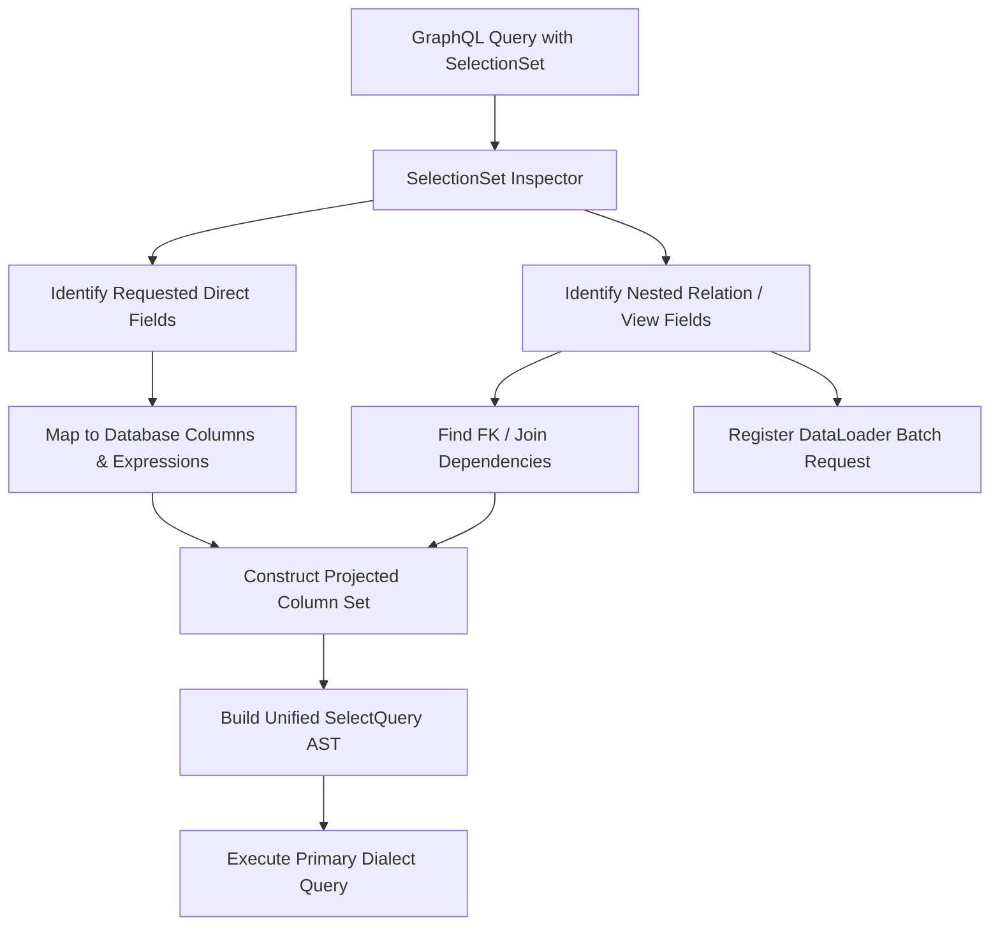

# GraphORM Query Planner & Optimization

This skill provides deep technical guidance for the most critical component in GraphORM: the Selection-Set-Aware Query Planner.

For implementation roadmap and phase specifications, see:
- [PHASE_BREAKDOWN.md - Phase 11](file:///mnt/jithendra/Dev_Station/graphorm/docs/PHASE_BREAKDOWN.md)
- [QUERY_ENGINE_DESIGN.md](file:///mnt/jithendra/Dev_Station/graphorm/docs/QUERY_ENGINE_DESIGN.md)
- [PROGRESS_TRACKER.md](file:///mnt/jithendra/Dev_Station/graphorm/docs/PROGRESS_TRACKER.md)
- [DEFINITION_OF_DONE.md](file:///mnt/jithendra/Dev_Station/graphorm/docs/DEFINITION_OF_DONE.md)

---

## The Selection-Set Problem in Models and Views

In standard GraphQL architectures, naive resolvers fetch entire database rows (`SELECT *`) and execute downstream queries for every item in a list, causing severe N+1 query bottlenecks. In aggregated or joined views, naive approaches fetch all joined tables into memory and perform in-memory joins and aggregations.

GraphORM solves this with a **Unified Query Planner** that:
1. Analyzes the GraphQL `DataFetchingFieldSelectionSet`.
2. Projects only requested database columns.
3. Injects hidden dependency columns (e.g. foreign keys, join keys) required for downstream relation loading or join conditions.
4. Dynamically builds multi-table join and aggregation plans for GraphORM-defined views.
5. Pushes filtering, sorting, and pagination down to the database SQL query.
6. Batches relation queries via GraphQL `DataLoader`.

## Planning Algorithm for Models and Views



### Step 1: SelectionSet Inspection
- Traverse GraphQL selections, resolving fragments (`InlineFragment`, `FragmentSpread`).
- Ignore meta-fields like `__typename`.
- Respect client aliases.

### Step 2: Source Model Dependency Resolution (for Views)
- For GraphORM-defined views, inspect declared joins (`@@from`, `@@leftJoin`, `@@innerJoin`).
- Prune joins if no fields from a joined model are requested, unless the join is required for an active filter predicate (`WHERE`) or grouping (`GROUP BY`).
- For aggregations (`@aggregate(count: "e.id")`), ensure the aggregation expression is added to the SQL projection and source tables are joined.

### Step 3: Dependency Column Detection
- If `Student.department` or a view's nested relation is requested, the client might only ask for:
  ```graphql
  students {
      name
      department { name }
  }
  ```
- **Planner Rule**: The query planner detects that resolving `department` requires `Student.departmentId`. It automatically injects `department_id` into the SQL `SELECT` list as a hidden dependency (`isHiddenDependency = true`), ensuring downstream resolvers receive the foreign key while hiding it from the final client payload if not requested.

### Step 4: Database Pushdown Optimization
- Never load entire related tables into Java to perform filtering or aggregation.
- Map view filters (e.g. `gpa: { gte: 3.5 }`) directly into the SQL `HAVING` or `WHERE` clauses.
- Push server-side pagination (`LIMIT ? OFFSET ?`) to the primary database query.

### Step 5: DataLoader Batching (N+1 Elimination)
- For 1-to-many (`Department.students` or `StudentDashboard.courses`):
  Collect all parent identifiers in the current execution batch.
  Execute batched query: `SELECT id, name, department_id FROM students WHERE department_id IN (?, ?, ?, ...)`.
- For many-to-1 (`Student.department`):
  Collect all foreign keys in the batch.
  Execute batched query: `SELECT id, name FROM departments WHERE id IN (?, ?, ?, ...)`.
- Dispatch batched results back to individual parent entities using map key correlation.
