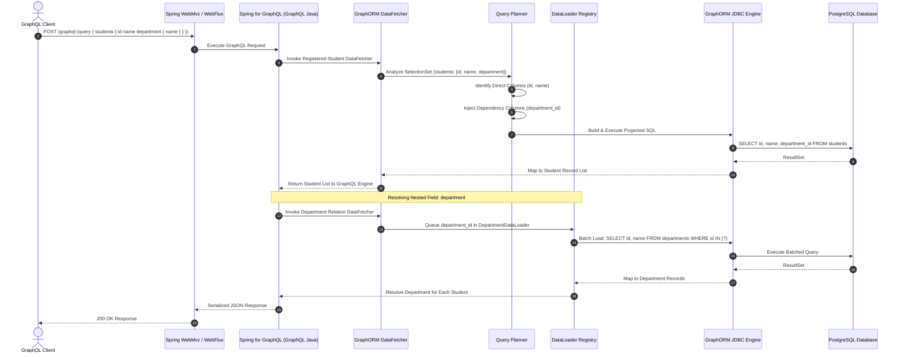
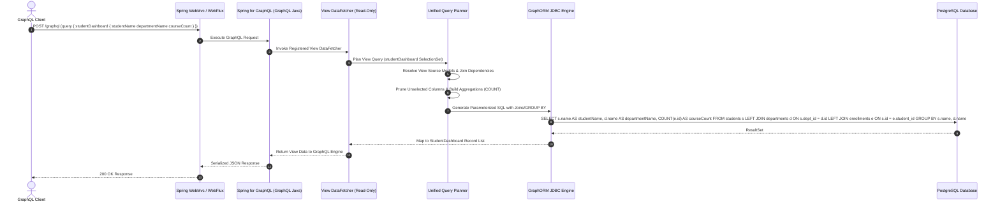

# GraphORM: System Architecture & Data Flow

## 1. Architectural Philosophy

GraphORM is built on four core architectural principles:

1. **Hybrid Schema-First Architecture**: Database models (`model`), read-only views (`view`), and composite structures (`type`) are defined in a Prisma-inspired schema DSL (`schema.graphorm`). Public APIs are defined in standard GraphQL SDL (`schema.graphqls`). A mapping layer reconciles the two, allowing selective exposure of database fields and view projections.
2. **Unified Query Engine & Direct JDBC Execution**: Avoid JPA/Hibernate overhead, session state, and unpredictable fetching. GraphORM uses direct, parameterized JDBC with database-specific dialects (`SqlDialect`). Regular models and view models are unified under a single query AST and execution pipeline.
3. **Selection-Aware Execution**: The GraphQL execution engine feeds field selection trees into the query planner, which translates them directly into SQL `SELECT` projections with batched relationship loaders, eliminating over-fetching.
4. **First-Class View Model Integration**: Rather than treating multi-table projections or aggregations as ad-hoc DTOs or secondary queries, views are first-class schema entities. The query planner natively resolves view source dependencies, joins, and aggregations, pushing execution down to the database.

## 2. End-to-End Data Flow

### A. Regular Model Query Flow

### B. View Model Query Flow (GraphORM-Defined / DB-Backed)

## 3. Component Architecture

### A. Schema & Metadata Engine (`graphorm-core`, `graphorm-schema`)
- Parses `schema.graphorm` into an immutable `SchemaAST`.
- Distinguishes three core model categories:
  - **Regular Models (`ModelNode`)**: Physical tables, CRUD-capable.
  - **View Models (`ViewModelNode`)**: Read-only projections, joins, aggregations, database-backed (`@@view`, `@@map`) or GraphORM-defined (`from: Model`).
  - **Composite Types (`CompositeTypeNode`)**: Reusable nested data structures.
- Validates field types, scalar declarations, primary keys, view dependencies, expressions, and bidirectional relations.
- Produces an in-memory `ModelRegistry` containing `ModelMetadata`, `ViewModelMetadata`, `FieldMetadata`, `RelationMetadata`, and `CompositeTypeMetadata`.

### B. Unified Query Planner & Optimizer (`graphorm-graphql`, `graphorm-core`)
- Intercepts `DataFetchingEnvironment`.
- Inspects `DataFetchingFieldSelectionSet` to build an execution `QueryPlan`.
- Supports both regular model queries and complex view model queries within a unified planning abstraction.
- For view queries:
  - Resolves dependencies between source models and nested views.
  - Generates join and aggregation plans.
  - Computes minimal column projections while auto-injecting hidden foreign keys or join dependency columns.
  - Eliminates N+1 queries when navigating nested relations from or to views.

### C. JDBC Database Engine (`graphorm-jdbc`)
- Translates `SelectQuery`, `ViewModelQueryPlan`, `InsertQuery`, `UpdateQuery`, and `DeleteQuery` into dialect-specific parameterized SQL (`BoundSql`).
- Strictly enforces read-only execution on view models (mutations rejected at compile-time and runtime).
- Supports database-backed views (direct select against views/materialized views) and dynamic GraphORM-defined views (subqueries, CTEs, joins, and `GROUP BY` expressions).
- Manages connections, transactions, and execution.
- Maps `ResultSet` rows directly into immutable Java records or view DTOs via `DynamicRowMapper`.

### D. Spring Boot Starter (`graphorm-spring-boot-starter`)
- Auto-configures beans upon detecting `schema.graphorm` and a `DataSource`.
- Wires DataFetchers into GraphQL Java `GraphQLCodeRegistry`:
  - Registers Query & Mutation fetchers for regular models.
  - Registers **Query-only** fetchers for view models.
  - Ensures mutations are never registered for view models.
- Integrates transaction handling with Spring's `PlatformTransactionManager`.
