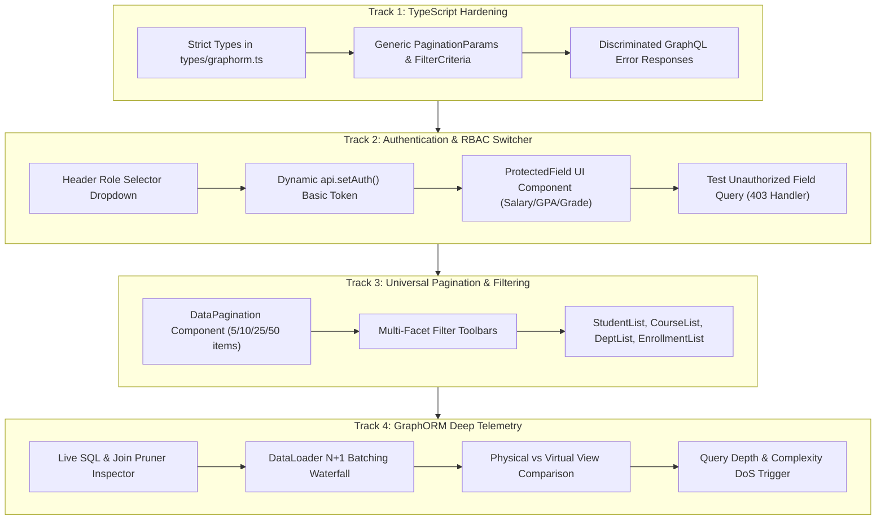

# GraphORM Frontend TypeScript & Complete Feature Showcase Plan

## 1. Executive Summary & Codebase Audit

### Current Architectural State
The GraphORM showcase frontend located in [`graphorm-examples/university-dashboard/frontend`](file:///mnt/jithendra/Dev_Station/graphorm/graphorm-examples/university-dashboard/frontend) is built with **React 18**, **Vite 6**, and **Tailwind CSS 3**, connected to a Spring Boot 3 + PostgreSQL backend.

While source files carry `.ts` and `.tsx` extensions, an audit of the frontend reveals several missing features and loose typing:
1. **Loose Typing & Type Escapes**: GraphQL query strings in [`api.ts`](file:///mnt/jithendra/Dev_Station/graphorm/graphorm-examples/university-dashboard/frontend/src/services/api.ts) use loose generic casts (`as any`), lacking auto-generated document node typing, strict response validation, and discriminated GraphQL error types.
2. **Static Role UI**: [`Header.tsx`](file:///mnt/jithendra/Dev_Station/graphorm/graphorm-examples/university-dashboard/frontend/src/components/layout/Header.tsx) renders a static badge (`Role: Dean / Admin`). There is no mechanism to switch credentials to test the backend's configured role-based access control (RBAC) and field-level `@auth` security.
3. **Inconsistent Pagination & Filtering**: Only [`StudentList.tsx`](file:///mnt/jithendra/Dev_Station/graphorm/graphorm-examples/university-dashboard/frontend/src/components/students/StudentList.tsx) implements in-memory slice pagination. [`CourseList.tsx`](file:///mnt/jithendra/Dev_Station/graphorm/graphorm-examples/university-dashboard/frontend/src/components/courses/CourseList.tsx), [`DepartmentList.tsx`](file:///mnt/jithendra/Dev_Station/graphorm/graphorm-examples/university-dashboard/frontend/src/components/departments/DepartmentList.tsx), [`EnrollmentList.tsx`](file:///mnt/jithendra/Dev_Station/graphorm/graphorm-examples/university-dashboard/frontend/src/components/enrollments/EnrollmentList.tsx), and [`AnalyticsView.tsx`](file:///mnt/jithendra/Dev_Station/graphorm/graphorm-examples/university-dashboard/frontend/src/components/analytics/AnalyticsView.tsx) have zero pagination. None support server-side pagination (`limit` / `offset`).
4. **Missing Demonstrations of Core GraphORM Features**:
   - Automatic relationship batching via `BatchRelationDataLoader` (solving N+1).
   - Selection-set projection pruning & dynamic SQL Join Pruning.
   - Stage 1 Physical Views (`@@view`, `@@map`) vs Stage 2 Virtual Joined Views (`@@from`, `@@leftJoin`, `@aggregate`).
   - Read-only view invariant enforcement (preventing mutations on views).
   - Security defenses against Denial of Service: Query Depth Limit (`MaxQueryDepthInstrumentation`) and Query Complexity Limit (`MaxQueryComplexityInstrumentation`).
   - Developer Tooling & CLI: Schema AST diagnostics, line/column validation error reporting, and JavaPoet record code generation.

---

## 2. Complete GraphORM Feature Matrix & Demonstration Plan

The updated plan guarantees **100% feature coverage** of the GraphORM framework in the showcase UI:

| # | GraphORM Feature | Architectural Layer | How It Will Be Demonstrated in the Example UI |
|---|---|---|---|
| **1** | **Field-Level Authorization (`@auth`)** | `graphorm-graphql`, Spring Security | **Interactive Role Menu** in Header switching between Dean (`ADMIN`), Faculty (`INSTRUCTOR`), Scholar (`STUDENT`), and Guest. Restricted fields (`salary`, `gpa`, `grade`) display dynamic lock badges or decrypted data depending on role. |
| **2** | **Zero-Code DataFetchers & Mutations** | `graphorm-graphql` | Automatic GraphQL queries and mutations for `createStudent`, `createCourse`, `createDepartment` with instant UI updates and toast notifications. |
| **3** | **DataLoader Batching (Anti N+1)** | `graphorm-graphql`, `BatchRelationLoader` | **DataLoader Visualizer**: Interactive waterfall tool showing traditional ORM N+1 queries (9 SQL queries) vs GraphORM DataLoader (2 SQL queries with `IN (?)`). |
| **4** | **Selection-Set Projection Pruning** | `graphorm-graphql`, `SelectionSetAnalyzer` | **Live SQL Inspector**: Checkbox selector for GraphQL fields; generated SQL dynamically updates to request only selected columns. |
| **5** | **Stage 1: Physical Views (`@@view`, `@@map`)** | `graphorm-jdbc`, `PostgreSqlDialect` | **Department Stats Showcase**: Direct read-only mapping to PostgreSQL pre-computed view with aggregations (`studentCount`, `courseCount`). |
| **6** | **Stage 2: Virtual Joined Views** | `graphorm-jdbc`, `ViewQueryPlanner` | **Student Dashboard Showcase**: Dynamic multi-table joins (`@@from`, `@@leftJoin`), expressions (`@expression`), and group-by aggregations (`@aggregate(count)`). |
| **7** | **SQL Join Pruning Optimization** | `graphorm-jdbc`, `JoinPruner` | In the SQL Inspector, unchecking joined columns (e.g. `departmentName`) causes the `LEFT JOIN departments` clause to be pruned from the generated SQL query in real-time. |
| **8** | **Strict View Read-Only Enforcement** | `graphorm-schema`, `graphorm-graphql` | Interactive test button attempting a mutation on `StudentDashboard` or `DepartmentStats`, displaying compile-time and runtime mutation rejection. |
| **9** | **Query Depth Defense** | `graphorm-graphql`, `MaxQueryDepth` | **DoS Defense Studio**: Trigger sending a deeply nested cyclic query (`student -> enrollments -> course -> department -> students...`), displaying `GraphOrmDepthExceededException`. |
| **10** | **Query Complexity Defense** | `graphorm-graphql`, `MaxComplexity` | **DoS Defense Studio**: Trigger sending a high-multiplier query, displaying `GraphOrmComplexityExceededException` protection. |
| **11** | **Dual-Engine Architecture (REST vs GraphQL)** | `graphorm-spring-boot-starter` | Global Engine Switcher in Header/Sidebar allowing seamless toggle between `/graphql` and `/api/university` endpoints with payload latency metrics. |
| **12** | **CLI Diagnostics & AST Generation** | `graphorm-cli`, ANTLR4 Parser | **Interactive Schema Studio**: Live schema editor with syntax checking, caret diagnostics (`Line 12:4 Invalid directive`), and Java 21 record preview emitted by JavaPoet. |
| **13** | **Type-Safe Filtering & Universal Pagination** | Frontend & Backend API | Reusable `<DataPagination />` component with page size selection (5, 10, 25, 50), jump-to-page, range sliders, and multi-facet filtering across all 4 entity lists and view tables. |

---

## 3. Workstream Execution Blueprint



---

## 4. Detailed Component Specifications

### 4.1 Strict TypeScript & Role Types (`src/types/graphorm.ts`)
```typescript
export type AcademicRole = 'ADMIN' | 'INSTRUCTOR' | 'STUDENT' | 'GUEST';

export interface UserRoleProfile {
  id: AcademicRole;
  label: string;
  badgeColor: string;
  username: string;
  secret: string;
  description: string;
  permissions: {
    canViewSalary: boolean;
    canViewGpa: boolean;
    canViewGrades: boolean;
    canMutate: boolean;
  };
}

export interface PaginationState {
  currentPage: number;
  pageSize: number;
  totalItems: number;
  totalPages: number;
}

export interface FilterState<T> {
  search: string;
  sortField: keyof T;
  sortOrder: 'asc' | 'desc';
  criteria: Record<string, unknown>;
}

export interface GraphQLErrorDetail {
  message: string;
  locations?: Array<{ line: number; column: number }>;
  path?: Array<string | number>;
  extensions?: {
    classification?: string;
    code?: string;
  };
}
```

### 4.2 Interactive Role Switcher (`src/components/layout/Header.tsx`)
- Dropdown menu featuring:
  - 👑 **Dean / Admin** (`admin:admin123`) — Unrestricted access to all data, mutations, and `@auth` fields.
  - 🎓 **Faculty / Instructor** (`instructor:prof123`) — Access to `gpa` and `grade`; restricted from `salary`.
  - 📚 **Scholar / Student** (`student:student123`) — Access to public directory; restricted from `salary`, peer `gpa`, and peer `grade`.
  - 👤 **Guest / Public** (`unauthenticated`) — Read-only catalog; mutations blocked with HTTP 401.
- Shows permission preview matrix popover explaining active permissions.
- Changing roles calls `api.setAuth(...)` and triggers a full UI reload with active permission updates.

### 4.3 Field Masking Component (`src/components/common/ProtectedField.tsx`)
- Renders:
  - Permitted: Actual value with an authorization checkmark.
  - Denied: Blur effect with lock icon and tooltip: `🔒 Protected by @auth(roles: ["ADMIN"])`.

### 4.4 Universal `DataPagination.tsx` Component
- Page size selector dropdown (`5`, `10`, `25`, `50`).
- Range indicator (`Showing 1-10 of 48 items`).
- Previous / Page Numbers / Next buttons with keyboard accessibility (`aria-label`).
- Integrated into:
  - `StudentList.tsx`
  - `CourseList.tsx`
  - `DepartmentList.tsx`
  - `EnrollmentList.tsx`
  - `AnalyticsView.tsx` (StudentDashboard table)

### 4.5 GraphORM Telemetry & Inspector Tools
1. **Live SQL & Join Pruning Inspector**:
   - Checkbox list of GraphQL fields.
   - Live view of generated SQL query.
   - Visual indicator showing unselected joins being pruned (`LEFT JOIN departments` removed when department fields are unchecked).
2. **DataLoader Batching Benchmark**:
   - Side-by-side execution graph comparing 9 individual SQL queries vs 2 batch SQL queries.
   - Shows database execution latency reduction.
3. **DoS Defense Simulator**:
   - Button "Execute Deep Query (Depth 8)" $\rightarrow$ GraphORM blocks with `GraphOrmDepthExceededException`.
   - Button "Execute High Complexity Query" $\rightarrow$ GraphORM blocks with `GraphOrmComplexityExceededException`.

---

## 5. Verification & Testing Protocol

- **TypeScript Verification**: Run `npx tsc --noEmit` to verify clean compilation with zero type errors.
- **Unit & Integration Tests**: Run `npm test -- --run` to verify Vitest tests covering:
  - Role switcher credential propagation in `api.ts`.
  - Pagination boundary conditions and calculations in `DataPagination.test.tsx`.
  - Protected field rendering across all 4 roles.
  - GraphQL partial error handling.
- **Production Build**: Run `npm run build` to verify Vite bundle optimization.
