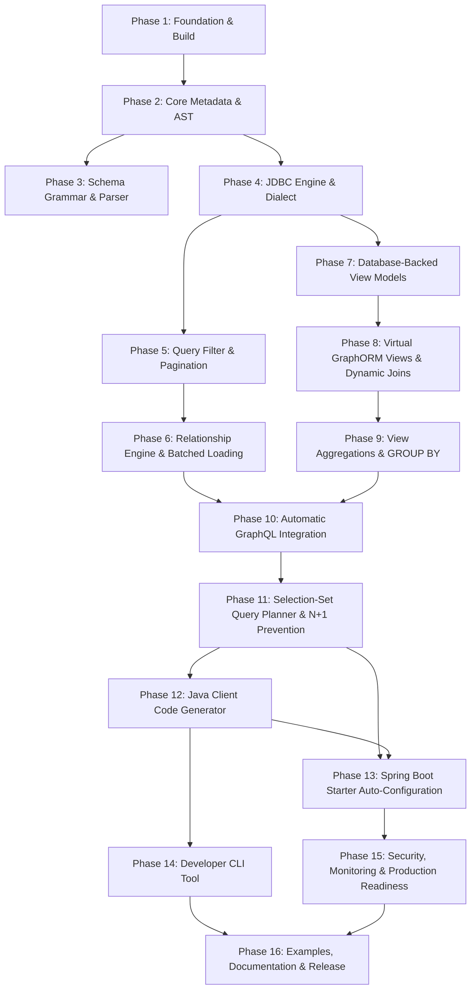

# GraphORM Implementation Roadmap

This document outlines the phased, architecture-first execution strategy for building **GraphORM**. Every phase is strictly ordered by functional dependency: lower-level foundations are completed, tested, and validated before higher-level abstractions are introduced.

---

## 1. High-Level Architectural Flow

```
+--------------------------------------------------------------------------+
| 1. Foundation Tier (Phases 1-3)                                          |
|    Multi-Module Maven Build, Shared Core Exceptions & Records,           |
|    ANTLR4 Grammar, Diagnostic Schema Parser & Semantic Validator         |
+--------------------------------------------------------------------------+
                                    |
                                    v
+--------------------------------------------------------------------------+
| 2. Core Engine Tier (Phases 4-13)                                        |
|    Unified Query AST, PostgreSQL Dialect, CRUD Builders, Testcontainers, |
|    Relationship Engine, Batched IN Loading, View Models (Physical &     |
|    Virtual Aggregations), GraphQL Java Engine, SelectionSet Planner,     |
|    JavaPoet Generator, Spring Boot Starter Auto-Configuration            |
+--------------------------------------------------------------------------+
                                    |
                                    v
+--------------------------------------------------------------------------+
| 3. Advanced Tier (Phases 14-15)                                          |
|    Developer CLI (`graphorm generate/validate`), GraphQL Complexity &   |
|    Depth Limits, Field Authorization, Metrics & Performance Monitoring   |
+--------------------------------------------------------------------------+
                                    |
                                    v
+--------------------------------------------------------------------------+
| 4. Reference App, Docs & Release (Phase 16 - v1.0.0 RELEASE READY)       |
|    University Reference Application, E2E Integration Suite,              |
|    Developer Guides & Quickstarts, Full Definition of Done Verification   |
+--------------------------------------------------------------------------+
```

---

## 2. Dependency Graph & Phase Sequencing

The roadmap enforces a strict, dependency-driven sequence:



---

## 3. High-Level Summary of Phases

| Phase | Title | Scope | Deliverables & Milestones |
|---|---|---|---|
| **Phase 1** | Project Foundation & Build System | Foundation | Multi-module Maven setup, Java 21, dependencies, CI scripts, shared exception base. |
| **Phase 2** | Core Metadata & Unified Query AST | Foundation | Immutable `ModelMetadata`, `ViewModelMetadata`, `SelectQuery` AST, `ModelRegistry`. |
| **Phase 3** | Schema Grammar, Parsing & Validation | Foundation | ANTLR4 parser, AST visitor, caret diagnostics, semantic validator. |
| **Phase 4** | Database Engine & SQL Generation | MVP | `PostgreSqlDialect`, `SelectBuilder`, `DynamicRowMapper`, Testcontainers. **Milestone 1**. |
| **Phase 5** | Query Filters, Pagination & Sorting | MVP | `WherePredicate` tree, parameterized `WhereClauseBuilder`, pushdown pagination. |
| **Phase 6** | Relationship Metadata & Batched Loading | MVP | 1:1, 1:N, N:1, N:M relations, batch loading `WHERE id IN (?)`, statement assertions. |
| **Phase 7** | Database-Backed View Models (Stage 1 Views) | Core | `@@view`, `@@map`, read-only query planning against existing DB views. **Milestone 2**. |
| **Phase 8** | Virtual GraphORM Views & Dynamic Joins | Core | `@@from`, `@@leftJoin`, `@@innerJoin`, join trees, pushdown filters. |
| **Phase 9** | View Aggregations & GROUP BY | Core | `@aggregate(count/sum/avg)`, `@expression`, `GROUP BY`, `HAVING`, join pruning. **Milestone 3**. |
| **Phase 10** | Automatic GraphQL Integration | Core | GraphQL Java wiring, SDL mapping, auto Query/Mutation fetchers, view read-only guards. **Milestone 4**. |
| **Phase 11** | Selection-Set Query Planner & N+1 Prevention | Core | SelectionSet analysis, selective SQL projection, hidden FK injection, DataLoader. **Milestone 5**. |
| **Phase 12** | Java Client Code Generator | Core | JavaPoet generator: records, inputs, filters, `GraphOrmClient`, compiler tests. **Milestone 6**. |
| **Phase 13** | Spring Boot Starter Auto-Configuration | Core | `@AutoConfiguration`, DataSource binding, `@Transactional` integration, `GraphQlSourceBuilderCustomizer`. **Milestone 7**. |
| **Phase 14** | Developer CLI Tool | Advanced | Picocli CLI: `graphorm validate`, `graphorm generate`, `graphorm init`. |
| **Phase 15** | Security, Monitoring & Production Readiness | Advanced | Depth/complexity limits, field authorization (`@auth`), Micrometer metrics, caching. **Milestone 8**. |
| **Phase 16** | Examples, Documentation & Release | Release | Complex university example app, documentation polish, quickstarts, release v1.0. **Milestone 9 - Completed**. |

---

## 4. End-to-End Measurable Milestones

The roadmap is anchored by 9 end-to-end, runnable milestones demonstrating practical capabilities:

### Milestone 1 (End of Phase 4): Pure JDBC Model CRUD
- **Capability**: Define a model in schema, validate it, connect to PostgreSQL, execute `InsertQuery`, read the record back via `SelectQuery` without writing a DAO, RowMapper, or entity class.
- **Verification**: Testcontainers PostgreSQL integration test.

### Milestone 2 (End of Phase 7): Database-Backed View Querying
- **Capability**: Declare a `view` mapped to a PostgreSQL view (`vw_student_summary`), execute filtered and paginated queries, and assert that write mutations throw `ReadOnlyViewException`.
- **Verification**: Testcontainers PostgreSQL view test.

### Milestone 3 (End of Phase 9): Virtual View with Dynamic Joins & Aggregations
- **Capability**: Define `view StudentDashboard` with `@@from`, `@@leftJoin`, and `@aggregate(count: "e.id")`. Execute a query and verify that GraphORM generates a single parameterized SQL statement with `LEFT JOIN` and `GROUP BY`, pushing execution to PostgreSQL with zero in-memory joins.
- **Verification**: Query interceptor asserts single SQL statement and correct aggregation numbers.

### Milestone 4 (End of Phase 10): Zero-Boilerplate GraphQL Integration
- **Capability**: Boot a Spring Boot application with `schema.graphorm` and `schema.graphqls`. GraphORM automatically registers all queries and mutations. Query `{ students { id name } }` executes successfully without writing a single DataFetcher.
- **Verification**: `GraphQlTester` test execution.

### Milestone 5 (End of Phase 11): Selection-Set Projected SQL & Zero N+1 Queries
- **Capability**: Execute GraphQL query `{ students { id name department { name } } }`. Verify via SQL assertion that exactly 2 SQL queries are executed (1 for students projecting only `id, name, department_id`, and 1 batched query for departments `WHERE id IN (?)`). Assert zero N+1 queries.
- **Verification**: Statement interceptor asserts exactly 2 SQL executions and projected column set.

### Milestone 6 (End of Phase 12): Type-Safe Java Client API
- **Capability**: Generated Java 21 records and client execute `db.student().findMany(q -> q.where(s -> s.name().eq("Alice")))` and `db.studentDashboard().findMany(...)`. Read-only views have no write methods.
- **Verification**: In-memory `JavaCompiler` asserts clean compilation and execution.

### Milestone 7 (End of Phase 13): Zero-Config Spring Boot Starter
- **Capability**: Add `graphorm-spring-boot-starter` to a Spring Boot app. The application boots, auto-configures `GraphOrmClient`, binds to Spring's `DataSource` and `@Transactional`, and exposes the GraphQL API.
- **Verification**: `ApplicationContextRunner` and integration tests.

### Milestone 8 (End of Phase 15): Production-Hardened Security & Observability
- **Capability**: Malicious nested queries exceeding complexity/depth limits are rejected before execution. `@auth` protected fields are shielded from unauthorized users. Query metrics are recorded via Micrometer.
- **Verification**: Security unit and integration tests.

### Milestone 9 (End of Phase 16): University Reference Application & Release Readiness
- **Capability**: Complete runnable Spring Boot 3 + PostgreSQL university reference application demonstrating models, physical views, virtual aggregated views with dynamic joins, automatic GraphQL wiring, DataLoader batching, `@auth` field authorization, GraphiQL UI, and type-safe Java 21 Client APIs.
- **Verification**: 23/23 end-to-end integration tests passing against live PostgreSQL, clean `mvn clean verify` with zero compiler warnings across all 10 modules.

---

## 5. Detailed Phase Specifications Reference

For the comprehensive task-by-task breakdown, class definitions, inputs/outputs, dependencies, and completion criteria for every phase, refer to:
👉 [PHASE_BREAKDOWN.md](file:///mnt/jithendra/Dev_Station/graphorm/docs/PHASE_BREAKDOWN.md)

For the live task execution status, refer to:
👉 [PROGRESS_TRACKER.md](file:///mnt/jithendra/Dev_Station/graphorm/docs/PROGRESS_TRACKER.md)
