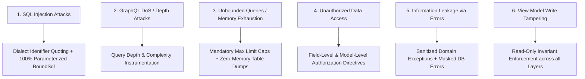

# GraphORM: Security Architecture & Access Control

## 1. Security Philosophy & Principles

As an infrastructure framework responsible for database query generation, data access, and GraphQL execution, GraphORM adheres to strict security defaults:
1. **Zero Trust on User Input**: Every input string, argument, filter parameter, and GraphQL query is treated as untrusted.
2. **Compile-Time and Dialect Defense**: Database queries must be fundamentally incapable of SQL injection by architectural design, not by developer vigilance.
3. **Denial of Service (DoS) Hardening**: GraphQL allows clients to request arbitrary nested graphs. GraphORM enforces strict depth, complexity, and pagination limits.
4. **Least Privilege & Immutability**: Read-only projections (view models) cannot be written to under any circumstance.
5. **Safe Error Handling**: Error messages must never leak database credentials, connection strings, table schemas, or internal stack traces to clients.

---

## 2. Threat Modeling & Defenses



---

## 3. SQL Injection Prevention

### 3.1 100% Parameterized Execution
- **Strict Prohibition**: GraphORM strictly prohibits string concatenation or `String.format` for SQL values.
- **`BoundSql` Pattern**: Every query builder in `graphorm-jdbc` produces an immutable `BoundSql(String sql, List<Object> parameters)`.
- **Positional Placeholders**: All criteria values, IDs, limit, offset, and insert/update values are converted to positional parameter markers (`?`).
- **JDBC `PreparedStatement`**: Queries are executed exclusively via `PreparedStatement`, ensuring the database engine parses the query plan independently of user values.

### 3.2 Identifier Quoting and Whitelist Validation
- **Problem**: Table names, view names, column names, and aliases cannot be parameterized in ANSI SQL.
- **Defense 1 - Metadata Whitelist**: The query engine resolves all requested fields against the immutable `ModelRegistry`. If an identifier does not exist in `ModelMetadata` or `ViewModelMetadata`, the query is rejected during planning before touching JDBC.
- **Defense 2 - Dialect Quoting**: All generated identifiers are escaped using `SqlDialect.quoteIdentifier()`. For PostgreSQL, every identifier is enclosed in double quotes (e.g. `"students"`, `"department_id"`), neutralizing any attempt to escape or inject SQL commands via column or table names.

---

## 4. GraphQL Denial of Service (DoS) Defenses

GraphQL gives clients the flexibility to query nested relationships. Without protection, malicious or poorly constructed queries can trigger denial of service:

### 4.1 Query Depth Limiting
- Configurable maximum query depth (default: 8 levels).
- Queries exceeding the configured depth are rejected before execution:
  ```yaml
  graphorm:
    security:
      max-query-depth: 8
  ```

### 4.2 Query Complexity Analysis
- Each field is assigned a complexity score (e.g., scalar = 1, relationship = 5, paginated list = 10 * multiplier).
- GraphORM provides a custom `MaxQueryComplexityInstrumentation` integrated with GraphQL Java.
- If the total complexity score of a document exceeds `graphorm.security.max-query-complexity` (default: 200), the request is rejected immediately with `GraphOrmComplexityExceededException`.

### 4.3 Unbounded Query Protection
- In raw GraphQL, an unpaginated query (`students { id }`) could attempt to fetch millions of rows.
- GraphORM enforces a global maximum limit (default: 100) on all list queries. If a client omits the `limit` argument or requests `limit: 10000`, the engine caps the value at `graphorm.security.max-page-size`.

---

## 5. Authorization & Access Control

GraphORM supports declarative authorization at both model and field levels:

### 5.1 Schema Directives
```prisma
model Student {
    id         Int      @id @default(autoincrement())
    name       String
    email      String   @unique
    ssn        String   @map("ssn") @auth(roles: ["ADMIN"])
    tuitionDue Float    @auth(roles: ["ADMIN", "FINANCE"])
}
```

### 5.2 Field-Level Authorization Interceptor
- Before generating the query plan, the `SecurityPlannerInterceptor` inspects the authenticated user's principal and authorities from Spring Security (`SecurityContextHolder`).
- If an unprivileged user attempts to select `@auth` protected fields, the query planner throws an `AccessDeniedException` or optionally masks the field with `null`.

---

## 6. Sensitive Data & Error Sanitization

### 6.1 Schema-Driven Field Exclusion
- Database fields marked with `@private` or excluded from `schema.graphqls` are never exposed in the GraphQL schema.
- Hidden dependency columns (such as foreign keys injected for DataLoader batching) are flagged with `isHiddenDependency = true` and stripped from the result map before response serialization.

### 6.2 Error Sanitization
- Database-level exceptions (`PSQLException`, constraint violations) are caught by `GraphOrmExceptionHandler` and mapped to client-safe error codes.
- Stack traces and raw SQL strings are logged to application server logs at `DEBUG`/`ERROR` level, but sanitized error responses (`"INTERNAL_ERROR"`, `"INVALID_ARGUMENT"`, `"RECORD_NOT_FOUND"`) are returned to API clients.
