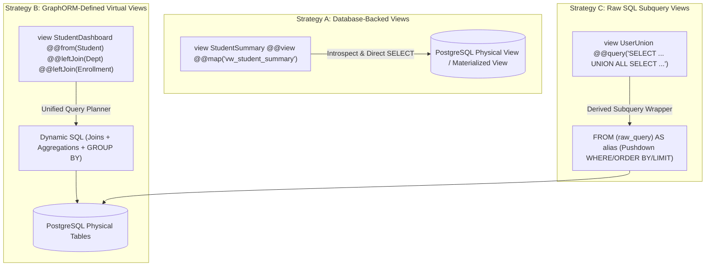
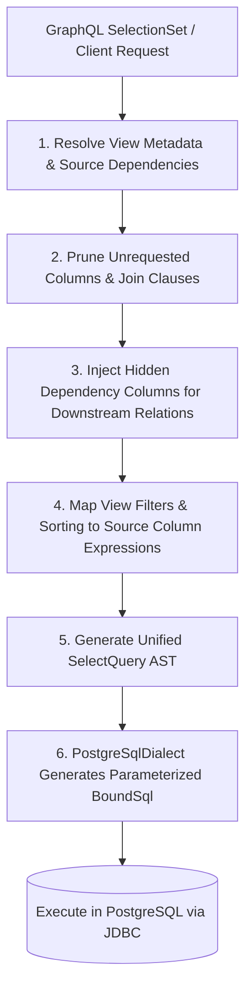

# GraphORM: View Model Architecture & Engineering Design

## 1. Overview & Vision

In enterprise application development, reading multi-table projections, aggregated metrics, and computed views constitutes the vast majority of database traffic. Traditionally, Spring Boot developers are forced to write massive amounts of boilerplate code:
- Custom DTO projection records.
- Entity-specific RowMappers and multi-table SQL queries.
- DAO / Repository fetch methods.
- Custom GraphQL DataFetchers and resolvers.
- Manual DataLoader wiring to avoid N+1 queries when traversing relations from views.

**View Models (`view`)** are a first-class architectural primitive in GraphORM designed to eliminate this boilerplate entirely. They provide declarative, read-only data projections combining multiple models, relationships, aggregations, and computed expressions into one cohesive entity.

---

## 2. Model Categories & View Invariants

GraphORM strictly categorizes schema definitions into three primitives:

1. **Regular Models (`model`)**: Physical database tables with full CRUD capabilities.
2. **View Models (`view`)**: Read-only projections combining multiple models, joins, aggregations, and computed expressions.
3. **Composite Types (`type`)**: Reusable nested value objects (e.g., `Address`) without independent database identities.

### Core View Model Invariants:
- **Strictly Read-Only**: View models represent projections, calculations, and aggregations. Under no circumstances can a view model be mutated.
  - No write mutations (`create`, `update`, `delete`) are ever generated in the Java client or registered in GraphQL.
  - The schema validator rejects `@default(autoincrement())` or write directives on views.
  - The JDBC query builder throws `ReadOnlyViewException` if targeted by insert, update, or delete builders.
- **Unified Query Architecture**: View models do not use a separate or secondary query execution engine. They share the same query AST, SQL dialect abstraction, selection-set projection, pushdown filtering, pagination, and DataLoader batching as regular models.
- **Zero In-Memory Table Dumps**: All joins, aggregations, filters, and pagination are executed by the database engine (PostgreSQL). GraphORM never pulls whole tables into JVM memory to perform in-memory joins or calculations.

---

## 3. Three-Tiered View Strategy

GraphORM supports three distinct implementation strategies for view models:



### 3.1 Strategy A: Database-Backed Views (`@@view`)

Database-backed views map directly to physical views or materialized views managed in PostgreSQL (e.g., created via Flyway/Liquibase migrations or DBA scripts).

#### Schema Declaration:
```prisma
view StudentSummary {
    id             Int      @id
    name           String
    departmentName String   @map("dept_name")
    totalCredits   Int      @map("total_credits")

    @@view
    @@map("vw_student_summary")
}
```

#### Characteristics:
- Annotated with `@@view` and optional `@@map("view_name")`.
- Represents an existing database view or materialized view (`SourceTable.DatabaseView`).
- Execution generates direct `SELECT <projected_columns> FROM "vw_student_summary" WHERE ... LIMIT ? OFFSET ?`.
- Inherits all selection-set filtering, pagination, sorting, and projection pruning capabilities.
- Supports database introspection: `graphorm introspect` can detect PostgreSQL views and generate matching `view` declarations.

### 3.2 Strategy B: GraphORM-Defined Virtual Views

GraphORM-defined views are declared purely within `schema.graphorm` without requiring any physical database DDL view. The query engine generates dynamic SQL joins, subqueries, and aggregations at runtime.

#### Schema Declaration:
```prisma
view StudentDashboard {
    studentId      Int                 @map("s.id")
    studentName    String              @map("s.name")
    departmentName String?             @map("d.name")
    courseCount    Int                 @aggregate(count: "e.id")
    gpa            Float?              @expression("AVG(e.grade_points)")
    primaryAddress Address?
    advisor        Instructor?         @relation(fields: [s.advisorId], references: [id])

    // Declarative source and join definitions
    @@from(Student, as: "s")
    @@leftJoin(Department, as: "d", on: "s.departmentId == d.id")
    @@leftJoin(Enrollment, as: "e", on: "s.id == e.studentId")
    @@groupBy(["s.id", "s.name", "d.name", "s.advisorId"])
}
```

#### Characteristics:
- `@@from(SourceModel, as: "alias")`: Defines the primary driving model.
- `@@leftJoin(Model, as: "alias", on: "predicate")`: Declares a left outer join.
- `@@innerJoin(Model, as: "alias", on: "predicate")`: Declares an inner join.
- `@aggregate(count | sum | avg | min | max: "expression")`: Declares an aggregate field.
- `@expression("SQL expression")`: Declares a computed SQL expression.
- `@@groupBy(["alias.column", ...])`: Defines grouping columns required when aggregations are present.

### 3.3 Strategy C: Raw SQL Subquery Views (`@@query`)

Raw SQL subquery views enable complex SQL constructs that are impractical to express purely through declarative join annotations—specifically `UNION`, `UNION ALL`, Common Table Expressions (`WITH`), and Window Functions—while retaining full type-safety, automatic GraphQL schema generation, and query pushdown optimization.

#### Schema Declaration:
```prisma
view UserDirectory {
    id    Int    @id
    name  String
    email String
    role  String
    score Float

    @@query("""
        SELECT id, name, email, 'student' AS role, score FROM students
        UNION ALL
        SELECT id, name, email, 'instructor' AS role, score FROM instructors
    """)
}
```

#### Characteristics & Security Invariants:
- Declared with single-line `@@query("...")` or multiline triple-quoted `@@query("""...""")`.
- **Mutual Exclusivity**: A view must specify exactly one strategy: `@@view`, `@@from`, or `@@query`. Combining `@@query` with `@@view`, `@@from`, `@@leftJoin`, or `@@groupBy` is rejected at compile time.
- **SQL Security Validation**:
  - The query must begin with `SELECT` or `WITH`.
  - DDL and DML operations (`INSERT`, `UPDATE`, `DELETE`, `DROP`, `ALTER`, `TRUNCATE`, `CREATE`, `GRANT`, `EXEC`) are strictly forbidden and rejected during schema validation.
- **Derived Subquery Pushdown Execution**:
  - The JDBC query planner wraps the raw SQL in a derived subquery `FROM (<raw_query>) AS <alias>`.
  - Outer query pushdown filters (`WHERE`), ordering (`ORDER BY`), and pagination (`LIMIT`, `OFFSET`) are applied dynamically to the derived subquery with 100% positional parameter extraction (`?`).
  - View remains strictly read-only; attempts to call `create`, `update`, or `delete` on `GraphOrmClient` throw `ReadOnlyViewException`.

---

## 4. Query Planning & Pushdown Execution

The Unified Query Planner processes view models through the following 6-step pipeline:



### 4.1 Step 1: Source Dependency Resolution
The planner reads `ViewModelMetadata`, extracts the root source table (`@@from`, `SourceTable.view()`, or `SourceTable.rawSql()`), and constructs the appropriate execution plan.

### 4.2 Step 2: Join Pruning & Selective Projection
If a client query requests only `{ studentName departmentName }` from `StudentDashboard`, the query planner observes that no fields from the `Enrollment` table (`courseCount`, `gpa`) are requested. It prunes the `LEFT JOIN enrollments e` and omits the `GROUP BY` clause entirely, generating a significantly faster two-table join query:
```sql
SELECT s.name AS studentName, d.name AS departmentName
FROM "students" s
LEFT JOIN "departments" d ON s."department_id" = d."id"
```

### 4.3 Step 3: Hidden Dependency Column Injection
If the client requests a nested relationship on the view (e.g. `advisor { id name }`), the relation DataFetcher needs `advisorId` to invoke the `InstructorDataLoader`. The query planner detects this dependency and injects `s.advisor_id` into the SQL projection as a hidden column:
```java
new ProjectedColumn("s.advisor_id", "__hidden_advisorId", true)
```
The JDBC executor extracts this value for downstream batching, and strips it before the final GraphQL response is returned to the client.

### 4.4 Step 4: Pushdown Filtering, Sorting, and Pagination
Filters applied to view fields are translated to qualified source column predicates:
- `where: { courseCount: { gte: 3 } }` -> translated to `HAVING COUNT(e.id) >= ?`
- `where: { departmentName: { eq: "Computer Science" } }` -> translated to `WHERE d.name = ?`
- `where: { role: { eq: "instructor" } }` on `@@query` views -> translated to `WHERE alias."role" = ?`
- `orderBy: { gpa: DESC }` -> translated to `ORDER BY AVG(e.grade_points) DESC`
- `limit: 10, offset: 20` -> translated to `LIMIT ? OFFSET ?`

---

## 5. Aggregations and Computed Fields

View models natively support SQL aggregate functions without requiring subqueries:

| Directive | SQL Function | Dialect Output (PostgreSQL) |
|---|---|---|
| `@aggregate(count: "e.id")` | `COUNT` | `COUNT(e."id")` |
| `@aggregate(sum: "e.credits")` | `SUM` | `COALESCE(SUM(e."credits"), 0)` |
| `@aggregate(avg: "e.grade_points")` | `AVG` | `AVG(e."grade_points")` |
| `@aggregate(min: "e.score")` | `MIN` | `MIN(e."score")` |
| `@aggregate(max: "e.score")` | `MAX` | `MAX(e."score")` |
| `@expression("concat(s.first_name, ' ', s.last_name)")` | Custom Expression | `CONCAT(s."first_name", ' ', s."last_name")` |

---

## 6. Incremental View Model Delivery Stages

View model capabilities are rolled out progressively across the project roadmap:

- **Stage 1 (Phase 7)**: Database-backed views (`@@view`, `@@map`), read-only metadata, direct SELECT queries, pagination pushdown, and Testcontainers verification.
- **Stage 2 (Phase 8)**: Virtual GraphORM-defined views with `@@from`, `@@leftJoin`, `@@innerJoin`, and join tree construction.
- **Stage 3 (Phase 8)**: Filter, sort, and pagination pushdown across joined source models.
- **Stage 4 (Phase 9)**: Aggregations (`@aggregate`), computed expressions (`@expression`), `GROUP BY`, `HAVING`, and join pruning.
- **Stage 5 (Phase 11)**: Nested relationships on views, hidden dependency foreign key injection, and DataLoader batching.
- **Stage 6 (Phase 15)**: Raw SQL subquery views (`@@query`) for `UNION`, `UNION ALL`, CTEs, window functions, and advanced PostgreSQL queries.
